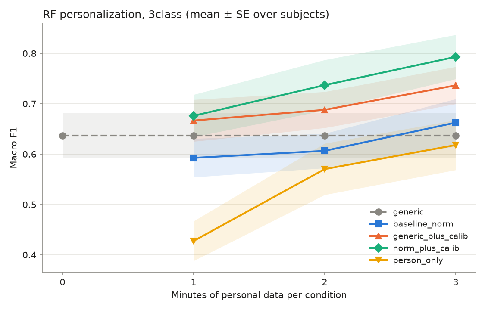

# Personalized Stress Detection from a Wrist Wearable

How much does a stress-detection model improve when it gets a few minutes of a
new person's own data? On the WESAD wrist data, 3 minutes per condition raises
3-class macro F1 from 0.64 to 0.79.

## Key result



A generic model trained on 14 other people reaches a macro F1 of 0.64 on the
3-class task (baseline / stress / amusement; F1 runs from 0 to 1, higher is
better). Adding 3 minutes per condition of the new person's data, with
baseline normalization (`norm_plus_calib`), raises it to 0.79. It helps 14 of
15 subjects (paired Wilcoxon p = 0.004). With a 1-minute gap between the
calibration data and the test data, the gain is still +0.12 (p = 0.012).

## Data

[WESAD](https://archive.ics.uci.edu/dataset/465/wesad) (Schmidt et al., 2018),
wrist sensor only (Empatica E4): blood volume pulse (BVP), skin conductance
(EDA), skin temperature (TEMP) and acceleration (ACC). 15 subjects, each
recorded in one lab session with a baseline, a stress task and an amusement
condition. The data is not included here; see [data/README.md](data/README.md)
for how to download it.

## Method

- **Preprocessing.** Labels are aligned to the signals by time, not by sample
  index. BVP is band-pass filtered and EDA is low-pass filtered. All signals
  are resampled to 32 Hz and cut into 60 s windows with a 5 s stride, keeping
  only windows with a single label.
- **Features.** Hand-crafted per window: EDA level, variability, slope and
  number of skin-conductance responses, plus temperature level, variability
  and slope.
- **Evaluation.** Leave-one-subject-out: train on 14 people, test on the 15th,
  repeat for everyone. Model: random forest (300 trees). Metric: macro F1,
  reported as mean ± SD across subjects.
- **Leakage-free test set.** For each person, the test set is every window
  starting 3 or more minutes into each condition. It is identical at every
  amount of calibration data, and calibration windows never overlap test
  windows in time.
- **Personalization methods,** with k = 0–3 minutes of the person's data per
  condition:
  1. **Generic:** other people only.
  2. **Baseline normalization:** subtract the person's average feature values
     from their first k minutes of rest. Needs no stress labels, only "sit
     still for k minutes".
  3. **Generic + calibration:** add the person's labelled windows, weighted to
     25% of the training set.
  4. **Normalization + calibration:** methods 2 and 3 combined.
  5. **Person-only:** train on the person's windows alone.

## What I found along the way

- **Movement predicts the label.** Acceleration alone scores a binary macro F1
  of 0.61 and a heartbeat signal-quality measure alone 0.74, because people
  move during the stress task. Both were removed from the main feature set so
  the model has to use physiology.
- **Raw heart-rate variability was mostly artifact.** Median baseline RMSSD was
  259 ms, far above normal resting values. After rejecting implausible
  inter-beat intervals it is 85 ms.
- **Wrist heart rate is unreliable under motion.** Peak-based heart rate is
  missing in 46% of stress windows, and a frequency-based estimate disagrees
  with it by 11.5 bpm on average. The main features are therefore EDA +
  temperature only.
- **"Sit still" calibration fails for some people.** For three subjects, skin
  conductance in the first minutes of the session is much higher than the rest
  of their baseline. Subtracting it shifts their data by about as much as
  stress does.

## Results (3 minutes per condition)

Macro F1, mean ± SD over 15 subjects. "Better" counts subjects who improved
over generic; p is a paired Wilcoxon test against generic.

| Method | Binary F1 | Better | p | 3-class F1 | Better | p |
|---|---|---|---|---|---|---|
| Generic | 0.842 ± 0.143 | – | – | 0.637 ± 0.172 | – | – |
| Baseline normalization | 0.853 ± 0.227 | 9 | 0.42 | 0.662 ± 0.182 | 9 | 0.42 |
| Generic + calibration | 0.868 ± 0.127 | 10 | 0.019 | 0.736 ± 0.143 | 11 | 0.005 |
| Normalization + calibration | 0.907 ± 0.189 | 12 | 0.056 | 0.793 ± 0.170 | 14 | 0.004 |
| Person-only | 0.925 ± 0.114 | 11 | 0.083 | 0.618 ± 0.192 | 8 | 0.64 |

The p-values are not corrected for multiple comparisons.

## Limitations

- **Small sample:** 15 subjects.
- **Single session:** calibration and test come from the same recording, so
  there is no cross-day test. Real-world gains are likely smaller.
- **Fixed protocol order:** baseline always comes first, so features that
  drift over the session can partly track time rather than stress.
- **No EDA response:** subject S14 has a median of zero skin-conductance
  responses in every condition.
- **Tiny k = 1:** 1 minute per condition is a single 60 s window per condition.

## Future work

- Validate wrist heart rate against the chest ECG in WESAD.
- Cross-day calibration on a dataset with multiple sessions per person.
- A 1D CNN on the raw signals, personalized by fine-tuning.
- Zero-shot stress classification by an LLM from text descriptions of each
  window.

## How to run

Requires Python 3.12 and the WESAD data in `data/WESAD/` (see
[data/README.md](data/README.md)).

```bash
python3.12 -m venv .venv
source .venv/bin/activate
pip install -r requirements.txt

python -m src.check_setup      # optional: check packages and data
python -m src.load             # preprocess into 60 s windows
python -m src.features         # per-window features -> results/features.csv
python -m src.baseline         # generic LOSO baseline
python -m src.ablation         # feature-set comparison
python -m src.personalize_rf   # personalization experiment and figures
python -m src.robustness       # robustness checks
```

All settings are in `src/config.py`.

## Citation

Schmidt, P., Reiss, A., Duerichen, R., Marberger, C., & Van Laerhoven, K.
(2018). Introducing WESAD, a multimodal dataset for wearable stress and affect
detection. *Proceedings of the 20th ACM International Conference on Multimodal
Interaction (ICMI)*.
